<p align="center">
  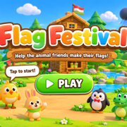
</p>
<h1 align="center">Flag Festival</h1>
<p align="center"><strong>Help the animal friends win back their flags — and learn the flags of the world along the way.</strong></p>
<p align="center">A playful, story-driven flag-learning game for children aged 6–8. It runs in any modern browser on a phone, tablet or computer, with nothing to install.</p>
<p align="center">
  <a href="https://snigdha-pal205.github.io/Flag-Festival/"></a>
</p>
<p align="center">
  
  
  
  
  
  
</p>
<p align="center">
  <a href="#game-tour">Game tour</a> · <a href="#how-a-game-flows">How a game flows</a> · <a href="#designed-for-young-children">Designed for children</a> · <a href="#run-locally">Run locally</a> · <a href="#architecture">Architecture</a>
</p>

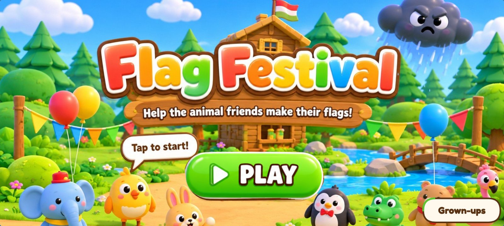

## Why Flag Festival

Young children remember what they **do**, not what they are told. Flashcards show a flag once; Flag Festival makes a child **paint it, build it, piece it together and catch it** — each time with the same flag — until they can pick it out on their own.

Everything is wrapped in a small story. Two animal friends have lost their real flags; their flags only show a big **"?"** and the name of their country. Every game a child finishes makes a friend livelier, and after four games the child earns that friend's real flag back. The game ends with a parade of friends proudly carrying the flags the child has learned.

## What children do

| Step | What the child does | What it builds |
| --- | --- | --- |
| **Opening parade** | Meets two friends carrying "?" flags with a country name. Pip the chick explains the mission. | A reason to care, and the country names. |
| **Map puzzle** | Drags each friend's country into its empty slot on a 3D map. | Where each country is, and its shape. |
| **Colour the flag** | Sees the real flag, watches Grumble wash it grey, then paints it back from the flag's own colours. | Colours and layout of the flag. |
| **Flag jigsaw** | Fits four chunky pieces back into a wooden frame. | The whole flag as one picture. |
| **Catch the flag** | Moves a basket to catch the right flag while Grumble drops look-alikes and wind gusts. | Telling a flag apart from similar ones. |
| **Build the flag** | Builds the flag from felt parts — stripes first, then emblems — ignoring three extra pieces that don't belong. | The flag's parts and their order. |
| **Choose the right flag** | After a friend's fourth game, puts the correct flag in a box. The "?" flag turns into the real one. | Recall, with no help: the real test. |
| **Final parade** | Watches both friends march with their real flags, with music and confetti. | A happy ending that rewards learning. |

Two map sets take turns on every PLAY:

| Set | Countries |
| --- | --- |
| **North Africa** | Algeria · Chad · Egypt · Libya · Niger · Sudan · Tunisia |
| **South Asia** | Afghanistan · Bangladesh · Bhutan · China · India · Nepal · Pakistan |

## Game tour

### A story to start

| Title screen on a phone | Opening parade |
| --- | --- |
| 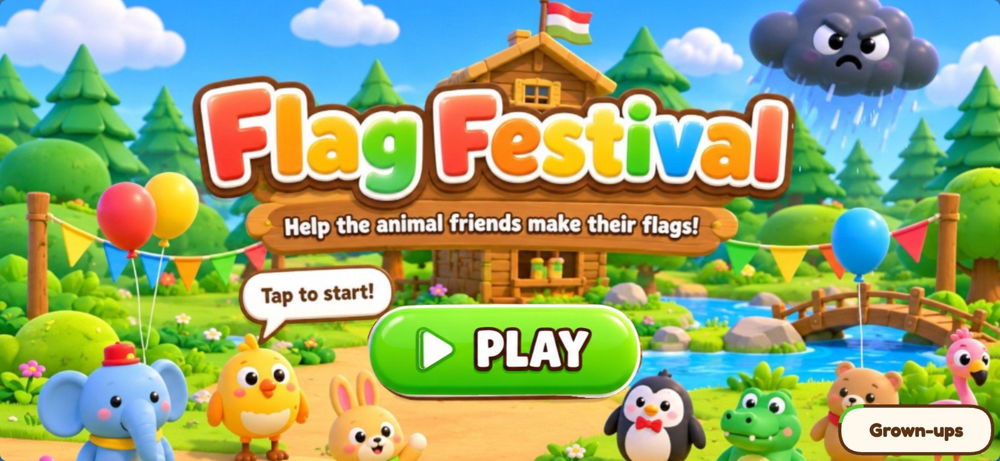 | 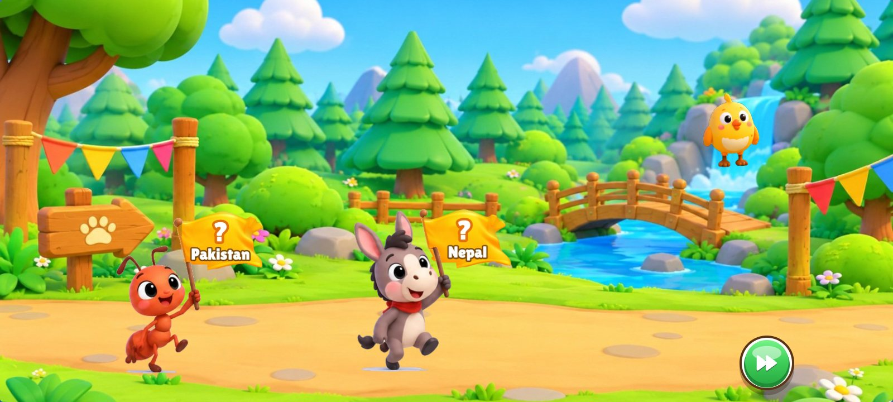 |
| **Fills any screen.** On phones it opens full screen after the first tap. | **Two friends, two mystery flags.** The country name is written on each "?" flag. |

### Find it, then make it

| Map puzzle | Colour the flag |
| --- | --- |
| 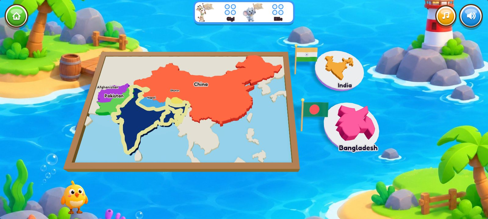 | 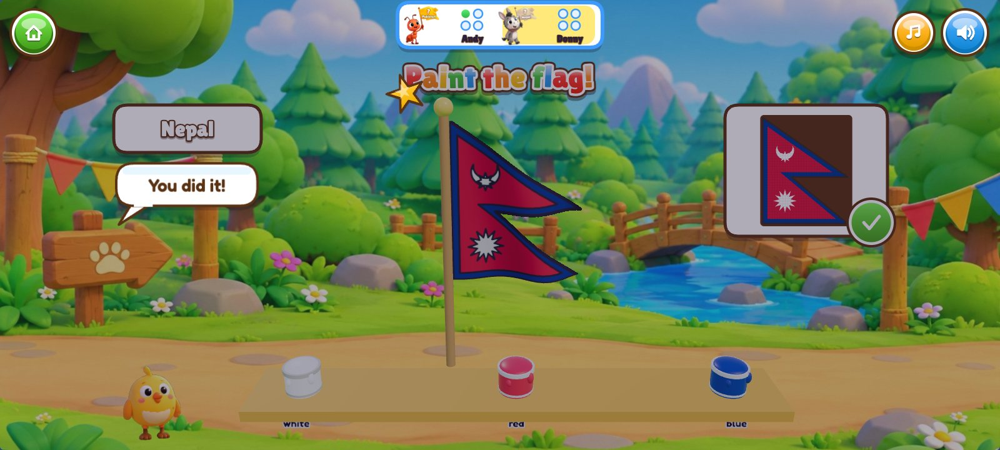 |
| **Put the countries back.** Small countries such as Nepal, Bhutan and Bangladesh are gently enlarged so little fingers can find them. | **Paint it back.** Only the flag's own colours are offered; three slips turn the help card over automatically. |

| Build the flag | Flag jigsaw |
| --- | --- |
| 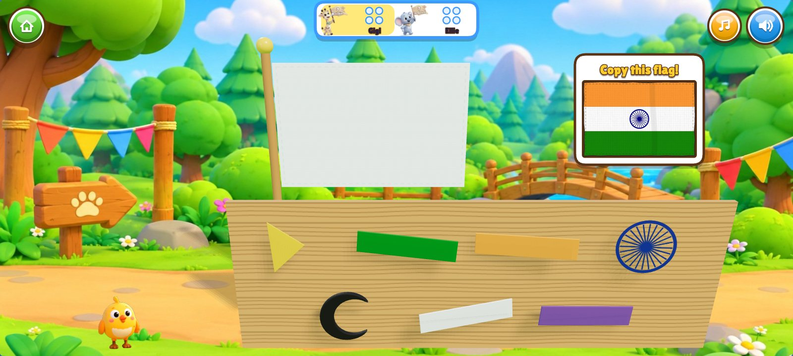 | 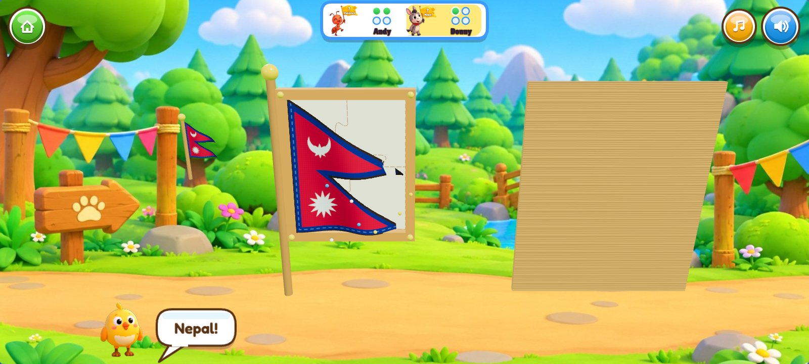 |
| **Stripes first, then the emblem.** Three extra pieces that are never copies of real ones make the child think. | **Always four pieces.** Enough to be a small challenge, never frustrating. |

### Prove it, then celebrate

| Catch the flag | Choose the right flag |
| --- | --- |
| 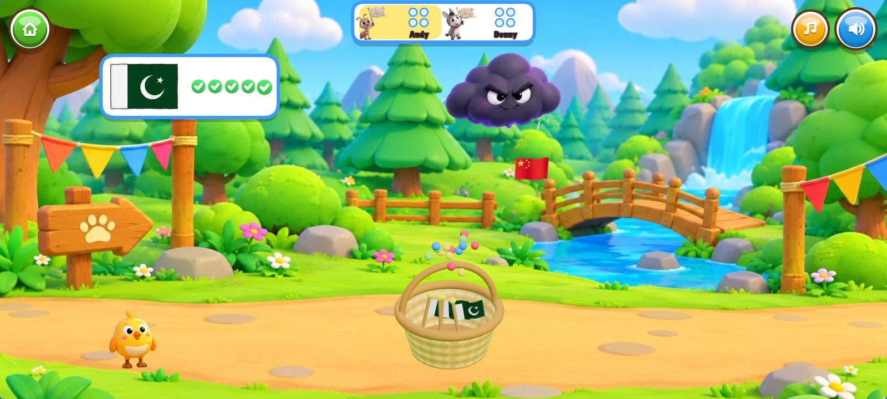 | 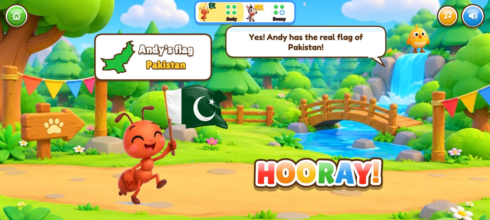 |
| **Grumble drops look-alikes.** A wrong catch brings a gust of wind — no losing, no game over. | **The "?" becomes real.** The friend comes forward holding the real flag. |

<details>
<summary><strong>The final parade</strong></summary>

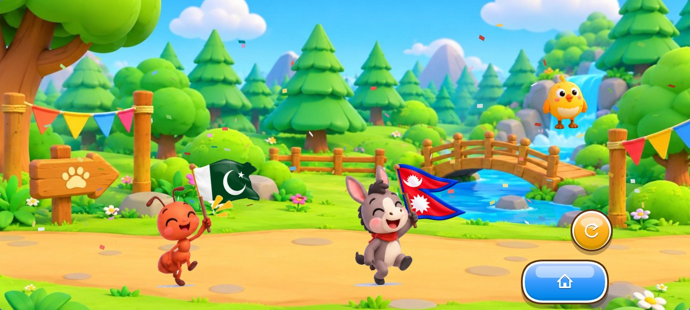

</details>

## How a game flows

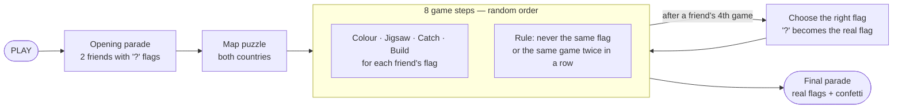

Before every step a short intro shows **which friend** the game is for. A strip at the top keeps both friends in view: each finished game adds a dot and makes the friend livelier — **asleep → awake → smiling → bouncing → dancing**.

## Designed for young children

- **Nobody fails.** A wrong answer bounces back gently — no red crosses, no "wrong", no lives, no timers, no game over. Every child can always finish.
- **Help arrives by itself.** If a child is stuck, Pip points, then glows the answer, then shows the move.
- **Voice for pre-readers.** Pip speaks every instruction aloud (with on-screen words), and the speaker button repeats it.
- **The same flag, many ways.** Each flag is met in five different activities, which is what makes it stick.
- **Calm, smooth motion.** Slow, soft animations; nothing flashes or overlaps the words a child is reading.
- **Big targets.** Pieces, paint jars and flags are large enough for small fingers on a phone.
- **Accurate content.** True flag colours and proportions; Nepal keeps its two-pennant shape; South Asia follows India's official map.

## Run locally

**Requirements:** a modern browser. Any simple web server will do; Python is shown here.

```bash
git clone https://github.com/Snigdha-pal205/Flag-Festival.git
cd Flag-Festival
python3 -m http.server 8080
```

Open [http://127.0.0.1:8080](http://127.0.0.1:8080) and press **PLAY**. There is no build step, no package install and no backend — the game is plain HTML, CSS and JavaScript.

<details>
<summary><strong>Play on a phone</strong></summary>

- Open the [live demo](https://snigdha-pal205.github.io/Flag-Festival/) and hold the phone sideways. The first tap switches to full screen.
- **iPhone:** Safari cannot make a web page full screen. Use **Share → Add to Home Screen** — the game then opens full screen from its own icon.

</details>

<details>
<summary><strong>For grown-ups</strong></summary>

Press and hold **Grown-ups** on the title screen for two seconds to open settings: turn music on or off, or reset progress. Progress is saved only in that browser.

</details>

## Architecture

Flag Festival is a **static, single-page web app**. A 3D world (Three.js / WebGL) is drawn underneath a flat SVG layer that holds buttons, cards, the friends and Pip's speech bubbles. Both share one 1280 × 720 stage that stretches to fill any screen shape.

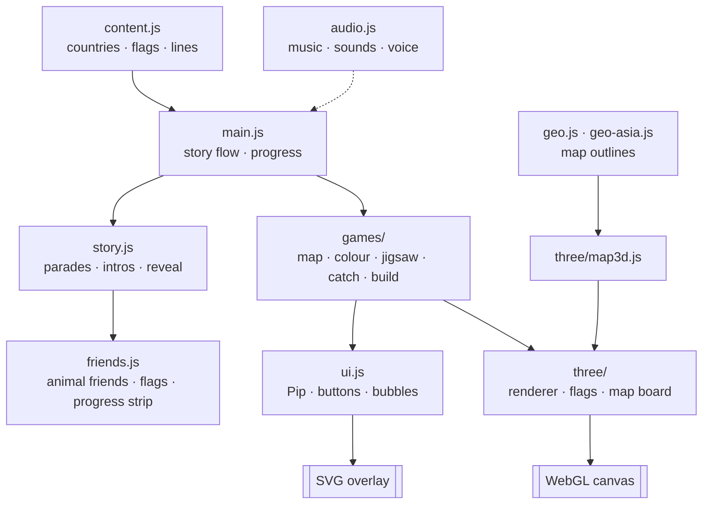

| Module | Responsibility |
| --- | --- |
| `index.html`, `css/` | The page, the stage and the rotate-your-device prompt. |
| `js/content.js` | All content in one place: countries, flag parts and colours, look-alikes, Pip's lines. |
| `js/main.js` | Session flow, random step order with its rules, progress saved in the browser, full screen on phones. |
| `js/story.js` | Opening and final parades, step intros and the "choose the right flag" reveal. |
| `js/friends.js` | The six animal friends, their moods, their flags (name flag → real flag) and the progress strip. |
| `js/games/` | The five activities: `map3`, `mapcolour` (Colour), `jigsaw`, `catch`, `build`. |
| `js/three/` | Renderer and backgrounds, waving cloth flags, flag parts, the 3D map board and characters. |
| `js/flags.js`, `js/geo*.js` | Flag drawing from parts, and the map outlines for both regions. |
| `js/ui.js`, `js/audio.js` | Pip, buttons and speech bubbles; synthesised music, sound effects and spoken lines. |
| `assets/` | Artwork: backgrounds, characters, friend frames, flag art and icons. |

### Built to run smoothly

- **Loads only what it needs.** The title screen comes first; other pictures load in the background, and only the two friends in play are downloaded.
- **Light assets.** Animation frames use WebP and every picture is sized to how large it appears on screen.
- **Adapts to the device.** Phones use lighter rendering settings, and if a device falls below about 45 fps the game automatically lowers its drawing quality until it runs smoothly.
- **Never freezes.** Friend pictures are prepared in the background without blocking the screen.

## Privacy

There are no accounts, no ads, no analytics and no tracking. Progress is stored only in the browser's local storage on the child's own device. The only external request is for the Google Fonts used for lettering.

## Credits

- **Game design and artwork direction:** [Snigdha-pal205](https://github.com/Snigdha-pal205).
- **Map outlines:** [Natural Earth](https://www.naturalearthdata.com/) (public domain), using the India point-of-view boundaries, simplified so neighbouring pieces fit exactly.
- **3D rendering:** [Three.js](https://threejs.org/) r158 (MIT licence), included in `js/vendor/`.
- **Fonts:** [Fredoka](https://fonts.google.com/specimen/Fredoka) and [Lilita One](https://fonts.google.com/specimen/Lilita+One) from Google Fonts.
